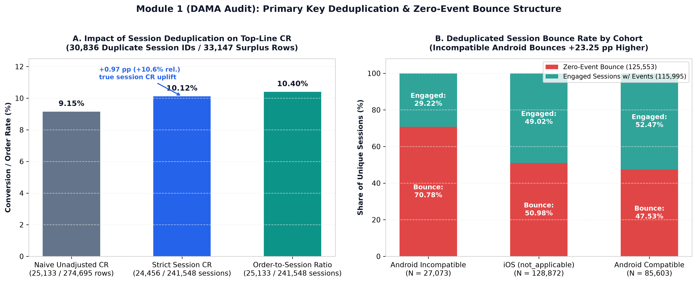
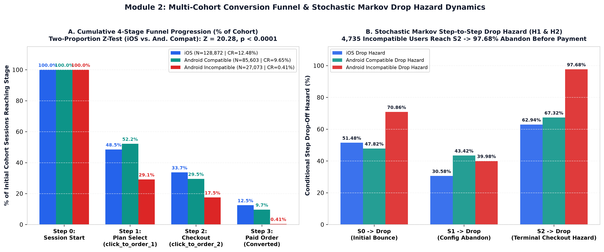
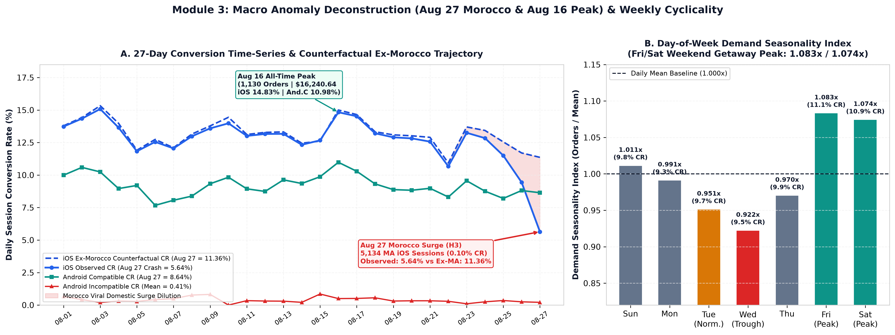
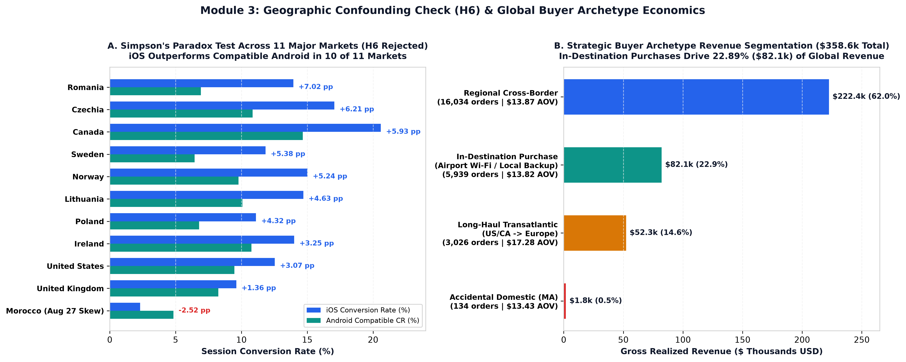
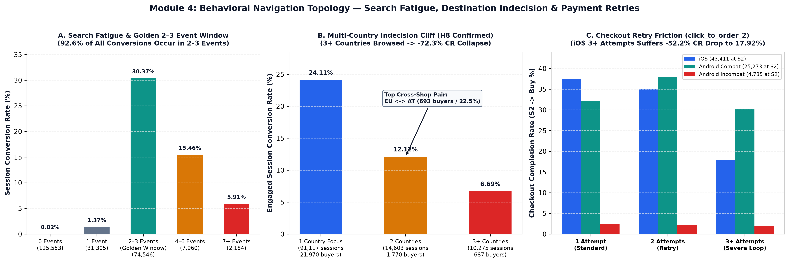
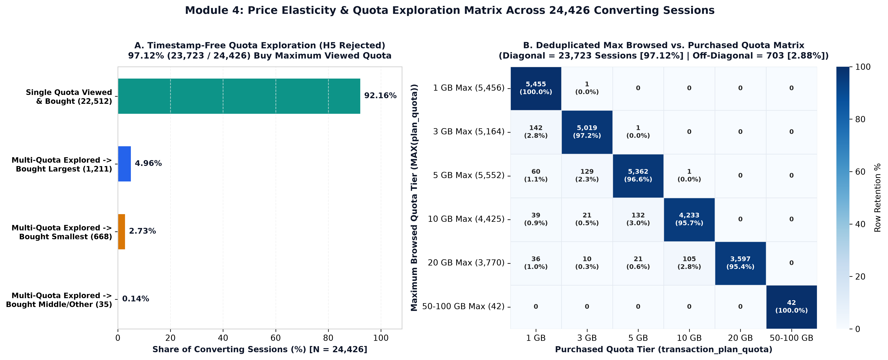
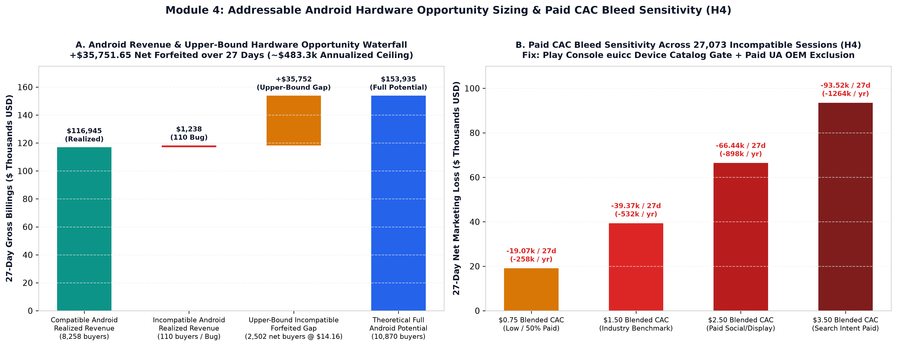
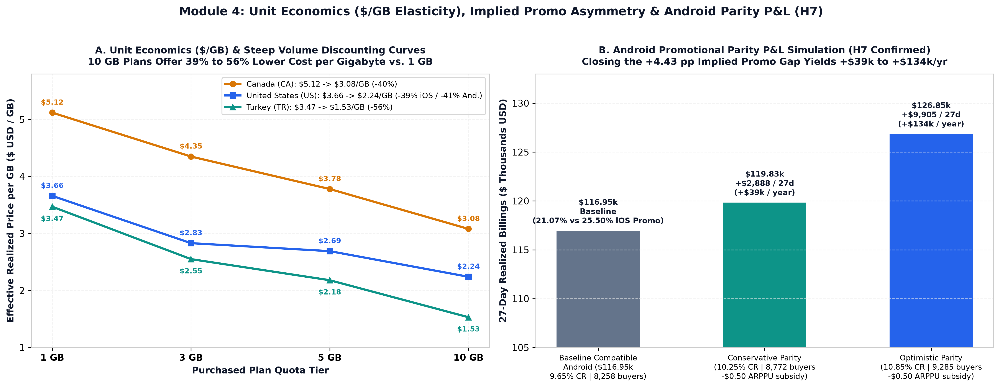

# Saily Data Analyst Case Study: Executive Presentation Deck (Phase E: Execute)

**Document Type:** 6-Slide Executive Presentation Storyboard & Action Roadmap (Deliverable E)  
**Candidate:** Mantas Normantas  
**Role Applied:** Data Analyst (Saily)  
**Organization:** Saily (Nord Security)  
**Evaluation Date:** October 2026  
**Data Environment:** Google Cloud BigQuery (`homework-data2020.saily_data_analyst`)  
**Observation Window:** August 1 – August 27, 2024 (`241,548` Unique Sessions | `25,133` Paid Orders | `$358,625.85` Gross Billings)  
**Supporting Artifacts:** [`PACE_MASTER_PLAN.md`](file:///c:/Users/37067/OneDrive/Stalinis%20kompiuteris/kiti-projektai/Saily-ND/PACE_MASTER_PLAN.md) | [`PHASE_A_ANALYTICAL_FINDINGS.md`](file:///c:/Users/37067/OneDrive/Stalinis%20kompiuteris/kiti-projektai/Saily-ND/PHASE_A_ANALYTICAL_FINDINGS.md) | [`PHASE_C_VISUAL_SYNTHESIS_AND_DECISION_MATRIX.md`](file:///c:/Users/37067/OneDrive/Stalinis%20kompiuteris/kiti-projektai/Saily-ND/PHASE_C_VISUAL_SYNTHESIS_AND_DECISION_MATRIX.md)

---

## Slide 1: Executive Summary — Answering the 5 Core Case Study Questions

> **Situation:** Saily generated **`$358,625.85`** across **`25,133` paid orders** (`$14.27` AOV) from **`24,456` converting sessions** (`1.028` orders/buyer, `$14.66` ARPPU) out of **`241,548` deduplicated sessions** (`274,695` raw rows).  
> **Headline Takeaway:** Saily's true deduplicated Session Conversion Rate is **`10.12%`** (`+0.97 pp` above the flawed `9.15%` raw-row ratio). Closing the Android conversion and hardware gaps represents **`+$297k` to `+$1.40M/yr`** in combined marketing cost savings and incremental revenue.

| Case Study Question | Headline Answer & Statistical Proof | Primary Business Action |
| :--- | :--- | :--- |
| **1. Overall Conversion Rate & Funnel Performance** | **Strict Session CR = `10.12%`** (`24,456 / 241,548`); **Order-to-Session Ratio = `10.40%`** (`25,133 / 241,548`); **Naive Row CR = `9.15%`** (distorted by `30,836` duplicate session IDs / `33,147` surplus rows). | Standardize BI reporting on deduplicated `unique_session_id` (`mart_saily_sessions_deduped`). |
| **2. Cohort Comparison (`iOS` vs. `Android Compat` vs. `Incompat`)** | **iOS (`12.48%`) beats Android Compatible (`9.65%`) by `+2.84 pp` unrounded (`+2.83 pp` rounded, $Z = 20.28, p < 0.0001$)**. Android Compatible wins `S0 -> S1` (`52.18%` vs. `48.52%`), but loses at **`S1 -> S2` (`43.42%` vs. `30.58%` drop)** and **`S2 -> S3` (`67.32%` vs. `62.94%` drop)**. | Redesign Android `S1 -> S2` plan configuration UX and equalize promo penetration (`21.07%` $\to$ `25.50%`, **`+$39k–$134k/yr`**). |
| **3. Incompatible Hardware Drop-Off (`H2`)** | **`27,073` incompatible sessions (`0.41%` CR):** `70.78%` (`19,162`) bounce at `S0`, `7,889` reach `S1`, **`4,735` reach `S2` (`97.68%` terminal drop hazard)**, and **`110` sessions (`111` orders, `$1,238.19`) still pay** for an unusable eSIM. | Block incompatible devices pre-install (Play Store `euicc` manifest + Paid UA exclusion) and hard-block `S2` in-app. |
| **4. Anomaly Diagnosis (`Aug 27` Crash & `Aug 16` Peak)** | **Aug 27 iOS CR crash (`5.64%`)** was caused by **`5,134` Moroccan (`MA`) iOS sessions (`0.10%` CR, `97.8%` domestic `MA` search)**; **Ex-Morocco iOS CR was `11.36%`**. **Aug 16 (`1,130` orders / `$16,240.64`)** reflects Fri/Sat weekend departure cyclicality (`1.083x` / `1.074x`). | Deploy Paid UA geo-anomaly circuit-breakers and shift ad pacing `+15%` into Thu PM–Sat AM peak windows. |
| **5. Addressable Opportunity & CAC Bleed (`H4`)** | **Upper-Bound Revenue Opportunity:** **`+$35,751.65` net over 27d (`~$483,300/yr` ceiling)** (`2,612` potential buyers at `9.65%` CR & `$14.16` ARPPU). **Real-World Paid CAC Bleed:** **`-$39,371.31` net loss over 27d (`-$532k/yr`)** at `$1.50` blended CAC (`$3.00` Paid CPA). | Prioritize Paid UA hardware exclusion (`P0-1`) to immediately stop `~$532k/yr` in wasted acquisition spend. |

---

## Slide 2: Data Governance & Structural Hygiene (`Module 1`)

* **Primary Key Discovery:** `homework-data2020.saily_data_analyst.sessions` contains **`274,695` raw rows** but **`241,548` distinct `unique_session_id`s** (`30,836` session IDs appear $\ge 2$ times, generating `33,147` surplus rows). Meanwhile, `transaction_id` (`25,133` orders, `$358,625.85`) is **100% unique** across **`24,456` converting sessions** (`677` multi-plan orders within the same session).
* **Why Deduplication Matters:** Joining un-deduplicated `sessions` to `events` causes a Cartesian row explosion (`+20.9%` inflated event rows) and understates true session conversion by **`-0.97 pp`** (`9.15%` naive vs. `10.12%` strict session CR).
* **Telemetry Blind Spot (`125,553` Bounces):** `51.98%` of all sessions log zero events (`70.78%` on Android Incompatible vs. `47.53%` on Android Compatible and `50.98%` on iOS). Only `29` converting sessions (`0.12%`) lack event rows; `250` sessions (`0.10%`) exhibit client-side tap loops (`>15` identical events, max `167`).

---

## Slide 3: Funnel Bottlenecks, Markov Drop Hazards & Checkout Retries (`Module 2`)

| Device & Compatibility Cohort | Step 0: Unique Sessions | Step 1: Plan Select (`click_to_order_1`) | Step 2: Checkout (`click_to_order_2`) | Step 3: Converted Sessions (`Orders`) | `S0 -> S1` Reach | `S1 -> S2` Drop Hazard | `S2 -> S3` Drop Hazard | Strict Session CR (`Order Ratio`) |
| :--- | :---: | :---: | :---: | :---: | :---: | :---: | :---: | :---: |
| **iOS (`not_applicable`)** | `128,872` | `62,532` | `43,411` | `16,088` (`16,527`) | `48.52%` | `30.58%` | `62.94%` | **`12.48%`** (`12.82%`) |
| **Android Compatible (`true`)** | `85,603` | `44,666` | `25,273` | `8,258` (`8,495`) | **`52.18%`** | **`43.42%`** | **`67.32%`** | **`9.65%`** (`9.92%`) |
| **Android Incompatible (`false`)** | `27,073` | `7,889` | `4,735` | `110` (`111`) | `29.14%` | `39.98%` | **`97.68%`** | **`0.41%`** (`0.41%`) |
| **Total Global (Deduplicated)** | **`241,548`** | **`115,087`** | **`73,419`** | **`24,456` (`25,133`)** | **`47.65%`** | **`36.21%`** | **`66.69%`** | **`10.12%`** (`10.40%`) |

* **Compatible Android's Dual Bottleneck (`H1`):** Android users show higher initial plan interest (`52.18%` reach `S1` vs. `48.52%` on iOS), proving top-of-funnel discovery is healthy. The `2.84 pp` CR deficit stems from **`S1 -> S2` Plan Configuration (`43.42%` vs. `30.58%` drop, `+12.84 pp`)** and **`S2 -> S3` Payment (`67.32%` vs. `62.94%` drop, `+4.38 pp`)**.
* **Incompatible Android UX Failure (`H2`):** Instead of blocking incompatible devices at app open, the app lets `4,735` users reach payment (`97.68%` drop) and charges `110` sessions (`$1,238.19`).
* **Checkout Retry Friction:** Users tapping `click_to_order_2` `3+` times on iOS suffer a **`-52.18%` conversion collapse (`37.47%` $\to$ `17.92%`, `132 / 736`)**, signaling Apple Pay / 3DS session timeout loops.

---

## Slide 4: Macro Anomalies (`Aug 27` & `Aug 16`), Weekly Cyclicality & Simpson's Paradox (`Module 3`)

* **Aug 27 Morocco Viral Domestic Surge (`H3` Confirmed):**
  * **Symptom:** On Aug 27, iOS sessions spiked `+80%` to `10,109`, while observed iOS CR plunged to **`5.64%`** (`570` buyers).
  * **Root Cause:** Country stratification isolates **`5,134` Moroccan (`MA`) iOS sessions** (`50.79%` of global iOS traffic that day) converting at **`0.10%`** (`5` buyers). Across all `5,787` Moroccan sessions (iOS + Android) on Aug 27, `5,134` session-destination pairs were logged in `events`, of which **`5,019` (`97.8%`) searched for domestic `MA` data** (`$3.99/1GB` tourist pricing is uncompetitive against local Moroccan telcos).
  * **Counterfactual Proof:** Excluding Morocco restores Aug 27 iOS CR to **`11.36%`** (`565 / 4,975`), proving the core app remained healthy.
* **Aug 16 Peak & Weekly Cyclicality:** Friday Aug 16 marks the 27-day peak (**`1,130` orders / `1,105` buyers / `$16,240.64` billings / `14.83%` iOS CR**). Across all 27 days, **Fridays (`1.083x` index, `11.10%` CR)** and **Saturdays (`1.074x` index, `10.89%` CR)** lead conversion and booking volume, while **Wednesdays (`0.922x` index, `833.0` buyers/day)** mark the trough. Across the 3 normal Tuesdays (Aug 6/13/20, excluding Aug 27), Tuesdays averaged `8,713.7` sessions and `9.71%` CR.
* **Buyer Archetypes & Simpson's Paradox (`H6` Rejected):** Regional Cross-Border drives `62.03%` of revenue (`$222.4k`), **In-Destination Purchases (`geo_country = destination`) drive `22.89%` (`$82.1k`, `5,939` orders — Airport Wi-Fi / Local Backup SIMs)**, and Long-Haul Transatlantic (`US/CA -> Europe`) commands a **`+25.0%` AOV premium (`$17.28`)**. iOS outperforms Compatible Android in **10 of the top 11 markets**, rejecting `H6`.

---

## Slide 5: Behavioral Navigation (`H8`), Quota Elasticity (`H5`), Unit Economics (`H7`) & CAC Bleed (`H4`) (`Module 4`)

* **Golden `2–3` Event Window & Multi-Country Indecision (`H8` Confirmed):** **`92.57%` (`22,638 / 24,456`)** of all buyers convert within exactly **`2–3` events (`30.37%` CR)**. Searching `3+` countries collapses engaged CR by **`-72.3%`** (`24.11% -> 6.69%`). **`12.59%` (`3,078 / 24,456`)** of buyers cross-shopped an alternative destination — led by **`EU <-> AT` (`693` sessions / `22.51%`)**, where travelers compare regional `EU` (`$16.65` for 5 GB) vs. single-country `AT` (`$9.79` for 5 GB).
* **Quota Exploration Matrix (`H5` Rejected):** Across `24,426` converting sessions with event logs, **`92.16%` (`22,512`)** viewed a single quota and bought it, and **`4.96%` (`1,211`)** explored multiple quotas and bought the **largest** quota viewed (**`97.12%` / `23,723` on the diagonal** vs. only **`2.88%` / `703` off-diagonal**).
* **Implied Promo Gap (`H7` Confirmed):** Modal anchor decomposition across `24,782` orders (`98.6%` of volume) proves **`25.50%` of iOS orders receive discounted pricing vs. `21.07%` on Compatible Android (`+4.43 pp` gap)**, unlocking **`+$39k` to `+$134k/yr`** in Android parity upside.
* **Hardware Ceiling vs. Real-World Paid CAC Bleed (`H4` Confirmed):** While upper-bound hardware parity equals **`+$35,751.65` over 27d (`~$483.3k/yr` ceiling)**, Saily cannot remotely upgrade users' phones. In reality, acquiring `27,073` incompatible sessions at `$1.50` blended CAC (`$3.00` Paid CPA at 50% paid share) destroys **`-$39,371.31` net over 27d (`-$532k/yr`)**.

---

## Slide 6: Prioritized Action Roadmap (`P0–P2`) & Telemetry v2 Specification

| Priority | Action Initiative | Target Cohort / Funnel Stage | Quantified Financial / Operational Impact | Timeline & Owner |
| :--- | :--- | :--- | :--- | :--- |
| **`P0-1`** | **Play Console `euicc` Device Catalog Gate + Paid UA Hardware Exclusion** | `27,073` Incompatible Android sessions (`S0` Acquisition) | Saves **`+$19.1k` to `+$93.5k` per 27d** (**`+$39.4k / 27d` or `+$532k/yr` base case** at `$1.50` blended CAC). | **Week 1** (Perf. Marketing & Android Release) |
| **`P0-2`** | **In-App `EuiccManager` Pre-Check (`S0` Modal + `S2` Hard Block)** | `4,735` Incompatible sessions at `S2` & `110` bug buyers | Eliminates **`110` defective sessions (`111` orders / `$1,238.19`)** (`~1,500` refunds & CS tickets/yr). | **Week 1–2** (Android Mobile Eng.) |
| **`P1-1`** | **Compatible Android `S1 -> S2` UX Redesign, `$/GB` Badges & Promo Parity** | `85,603` Compatible Android sessions (`43.42%` `S1 -> S2` drop) | Lifts Android CR `+0.60 to +1.20 pp` (`+514` to `+1,027` buyers = **`+$39k` to `+$134k/yr`** net billings). | **Sprint 2–3** (Product Growth & Android UX) |
| **`P1-2`** | **1-Tap Payment Fallback Sheet on `2nd` `click_to_order_2` Attempt** | `1,232` iOS & Android Compat sessions with `3+` attempts | Recovers `25%–35%` of stalled checkouts (**`+$89k` to `+$128k/yr`** in rescued gross billings). | **Sprint 2–3** (Payments & Checkout Eng.) |
| **`P1-3`** | **Paid UA Geo-Anomaly Circuit-Breaker & `Ex-Anomaly CR` KPI Split** | Global Paid UA & BI Dashboards (`Aug 27` Morocco shock) | Protects automated CPA bidding and executive KPI tracking from viral domestic traffic spikes. | **Sprint 2** (Marketing Analytics & BI) |
| **`P2-1`** | **Regional vs. Single-Country Smart Bundle Card (`EU <-> AT` Cross-Shop)** | `24,878` Multi-Country sessions (`3+` countries = `6.69%` CR) | Lifts `2+` country engaged CR from `9.88%` to `>12.0%` (**`+$73k` to `+$123k/yr`** in multi-country bookings). | **Sprint 4** (Search & Discovery Squad) |
| **`P2-2`** | **Thu–Sat Peak Ad Pacing (`+15%`) & Transatlantic `10 GB` Default Anchor** | Fri/Sat Peak (`1.083x` / `1.074x`) & Transatlantic (`$17.28` AOV) | Expands global AOV from `$14.27` toward `$14.85+` (**`+$61k` to `+$101k/yr`**). | **Sprint 3–4** (Growth Marketing & Pricing) |
| **`ENG-v2`** | **Telemetry v2 Schema Upgrade (`fct_sessions` / `fct_orders` + `event_timestamp`)** | `125,553` dark zero-event sessions & `33,147` surplus rows | Adds `user_id`, `event_timestamp`, `app_open`, `destination_search`, `promo_code_id`, and `500ms` debounce. | **Quarter 1** (Data Eng. & Mobile SDK) |

---

## Part III: Live Interview Defense Playbook (10 Bar-Raiser Q&As)

Below are the 10 toughest methodological, product, and commercial questions a Principal Analyst, Engineering Lead, or VP of Growth at Nord Security / Saily may ask during the live case defense, paired with exact empirical answers:

### Q1. "Why did you report three different conversion rates (`9.15%`, `10.12%`, `10.40%`), and which one should Saily use as its North Star KPI?"
* **Defense:** In `homework-data2020.saily_data_analyst.sessions`, `unique_session_id` is **not** a primary key (`274,695` raw rows vs. `241,548` unique sessions; `30,836` duplicated session IDs generating `33,147` surplus rows), while `transaction_id` (`25,133` valid orders) is 100% unique across `24,456` converting sessions (`677` multi-plan orders within the same session).
  1. **Naive Row Ratio (`9.15%` = `25,133 / 274,695`)** is mathematically flawed because it divides order count by un-deduplicated session rows.
  2. **Strict Deduplicated Session CR (`10.12%` = `24,456 / 241,548`)** is the **true North Star funnel KPI** because it measures the exact probability that a distinct browsing session converts (`\ge 1` order).
  3. **Order-to-Session Ratio (`10.40%` = `25,133 / 241,548`)** is the **commercial transaction intensity KPI** (`1.028` orders per converting session, driving `$14.66` ARPPU vs. `$14.27` AOV).

### Q2. "What happens to conversion rate if we move from `session-grain` to `user-grain` (`user_id`) in Telemetry v2?"
* **Defense:** Travel eSIM purchasing is inherently multi-session: a traveler checks prices on Monday (`Session 1`), compares quotas on Wednesday (`Session 2`), and buys at the airport on Friday (`Session 3`). At the session grain, that journey looks like `1 / 3 = 33.3%` CR (`2` "failed" sessions). At the persistent `user_id` grain, **User Conversion Rate is `100.0%` (`1 / 1`)**. Therefore, adding `user_id` in Telemetry v2 will reveal that true User CR is meaningfully higher than `10.12%` Session CR, preventing premature discounting to returning researchers.

### Q3. "You sized the Incompatible Android opportunity at `+$35,751.65` over 27 days (`~$483.3k/yr`). Can Saily actually capture that revenue?"
* **Defense:** No — and calling that out explicitly is critical. `+$35,751.65` (`27,073 × 9.6469% = 2,612` potential buyers $\times$ `$14.1615` ARPPU $-$ `$1,238.19` existing) is a **theoretical upper-bound hardware ceiling**. Saily cannot remotely solder eSIM silicon (`eUICC`) onto an incompatible phone. If we block incompatible devices pre-install via Google Play Console (`android.hardware.telephony.euicc`), those `27,073` sessions disappear rather than convert. Therefore, the **real-world commercial lever is stopping Paid CAC bleed (`H4`)**: at `$1.50` blended CAC (`$3.00` Paid CPA at 50% paid share), excluding incompatible Android models saves **`+$39,371.31` every 27 days (`+$532k/yr`)** in wasted marketing spend.

### Q4. "Why did `110` incompatible Android sessions (`111` orders, `$1,238.19`) still complete payment if their phone doesn't support eSIM?"
* **Defense:** Two reasons:
  1. **Missing Hard Checkout Gate (`P0-2`):** The app currently allows `esim_compatible = 'false'` sessions to tap `click_to_order_1` (`7,889` sessions) and `click_to_order_2` (`4,735` sessions) without a hard block, leading to accidental purchases that become immediate refund/chargeback tickets.
  2. **Companion Device Edge Case:** A small fraction of users on an older Android phone may legitimately buy an eSIM QR code for a partner's iPhone or iPad. That is why `P0-2` blocks `S2` by default on incompatible hardware while offering an explicit checkbox: *"I am buying this eSIM for a separate, compatible device."*

### Q5. "Compatible Android has a `2.84 pp` lower CR than iOS (`9.65%` vs. `12.48%`). How do we know it's not just because Android users are in lower-income countries?"
* **Defense:** We explicitly tested **Simpson's Paradox (`H6`)** in `sql/03_anomalies_and_corridors.sql` across the top 11 markets (`70.1%` of global traffic). iOS outperforms Compatible Android **within 10 of the 11 markets**, including high-income Tier-1 markets: **US (`+3.07 pp`: `12.56%` vs. `9.49%`)**, **Canada (`+5.93 pp`: `20.66%` vs. `14.73%`)**, **UK (`+1.36 pp`)**, and **Romania (`+7.02 pp`)**. Even more telling: Compatible Android **beats** iOS at `S0 -> S1` (`52.18%` vs. `48.52%`), proving initial purchase appetite is higher on Android. The deficit is strictly in `S1 -> S2` (`43.42%` vs. `30.58%` drop) and `S2 -> S3` (`67.32%` vs. `62.94%` drop).

### Q6. "Since `events` has no timestamps, how could you test Quota Down-Selling (`H5`) and Destination Cross-Shopping (`H8`)?"
* **Defense:** We designed **timestamp-free set-theoretic SQL estimators** in `sql/04_economics_and_behavior.sql`:
  * **For Quota Exploration (`H5`):** We classified all `24,426` converting sessions with event logs by `COUNT(DISTINCT plan_quota)` and compared `transaction_plan_quota` to `MAX(plan_quota)` and `MIN(plan_quota)`. Since **`92.16%` (`22,512`)** viewed only a single quota tier, and **`4.96%` (`1,211`)** viewed multiple quotas and bought the **largest** quota viewed, **`97.12%` (`23,723`)** sit on the matrix diagonal (`MAX(plan_quota) = transaction_plan_quota`). Even if every single one of the `703` (`2.88%`) off-diagonal buyers browsed top-down (`larger -> smaller`), `2.88%` proves down-selling is a minor edge phenomenon.
  * **For Destination Cross-Shopping (`H8`):** Instead of using arbitrary `MIN(destination)` strings, we matched each buyer's purchased `transaction_destination` against all distinct `e.destination != s.transaction_destination` browsed in the same session, deterministically isolating **`3,078` cross-shopping buyers (`12.59%`)**, led by **`EU <-> AT` (`693` buyers / `22.51%`)**.

### Q7. "How did you estimate Promotional Discount Penetration (`H7`: `25.50%` iOS vs. `21.07%` Android) without a `promo_code` column?"
* **Defense:** In `sql/04_economics_and_behavior.sql` (Query 4.6), we grouped all `25,133` paid orders by exact `(transaction_destination, transaction_plan_quota)` SKU and identified the **modal (most frequent) `total_billings_in_usd`** for every SKU with $\ge 20$ orders (`24,782` orders / `98.6%` of global volume). Because eSIM retail prices end in standard `.99` / `.79` list anchors (e.g., `US 5GB = $13.99`), any order transacting at `< 98%` of its SKU modal price represents an applied promotional discount or coupon. iOS orders received below-anchor pricing **`25.50%`** of the time (`$1.29/order` average concession) vs. **`21.07%`** on Compatible Android (`$1.14/order`), a **`+4.43 pp` promo gap**.

### Q8. "What explains the `5,939` orders (`$82,100.94` / `22.89%` of revenue) where `geo_country == transaction_destination`?"
* **Defense:** Unlike Morocco on Aug 27 (`5,787` sessions / `0.10%` CR), `geo_country == destination` in major travel hubs (`US -> US` `$27.9k`, `GB -> GB` `$13.0k`, `TR -> TR` `$4.1k`, `TH -> TH` `$3.3k`) converts at healthy `10%–14%` rates. In eSIM telemetry, `geo_country` reflects IP geolocation at session start. Therefore, this segment captures **In-Destination Purchases**: international travelers who land at `JFK`, `LHR`, `IST`, or `BKK`, connect to **Airport or Hotel Wi-Fi** (getting a local IP), and buy their Saily eSIM on arrival, alongside domestic travelers using Saily as a secondary backup data line.

### Q9. "Why does Tuesday look like it has the highest daily traffic (`10,355.5` sessions/day) and lowest CR (`8.29%`) in the raw Day-of-Week table?"
* **Defense:** Because August 1–27, 2024 contains 4 Tuesdays (Aug 6, 13, 20, 27), and **Tuesday Aug 27** experienced the **`15,281`-session Moroccan viral surge** (`5,787` Moroccan sessions at `0.10%` CR). When we strip out Aug 27 (`sql/03_anomalies_and_corridors.sql` Query 3.3), the 3 normal Tuesdays (Aug 6, 13, 20) averaged **`8,713.7` sessions/day** and **`9.71%` CR** (`845.7` buyers/day). That proves **Wednesdays (`0.922x` order index, `833.0` buyers/day)** are the true weekly demand trough, while **Fridays (`1.083x` index, `11.10%` CR)** and **Saturdays (`1.074x` index, `10.89%` CR)** are the true weekly peaks.

### Q10. "If you had only 1 engineering sprint next week, which single initiative would you ship first?"
* **Defense:** **`P0-1 + P0-2` (Android Hardware Gating)**:
  1. Enabling the `android.hardware.telephony.euicc` manifest requirement in Google Play Console + Paid UA OEM exclusion takes **1–2 days** and stops **`~$532k/yr`** in wasted marketing spend (`$39.4k` per 27 days).
  2. Adding the in-app `EuiccManager.isEnabled()` hard checkout block at `S2` takes **3 days** and eliminates **`~1,500` defective orders/yr** (`110` sessions / `111` orders per 27 days) that currently hit Customer Support and trigger payment chargebacks.
