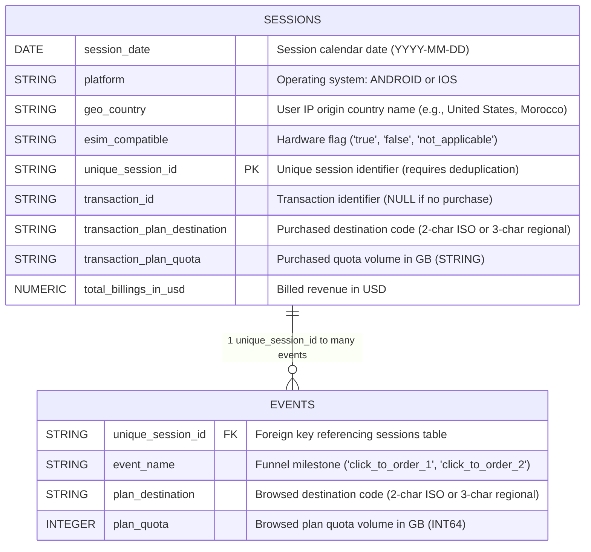
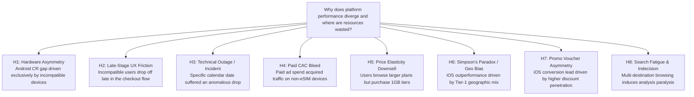
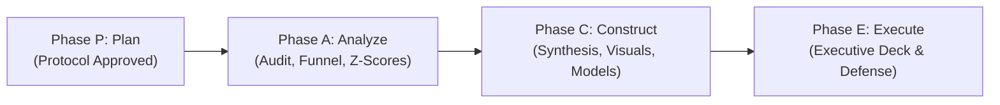

# Saily Data Analyst Case Study: PACE Methodology & Execution Plan

**Document Type:** Project Protocol & Analytical Methodology (Deliverable 1)  
**Candidate:** Mantas Normantas  
**Role Applied:** Data Analyst (Saily)  
**Organization:** Saily (Nord Security)  
**Evaluation Date:** October 2026  
**Data Environment:** Google Cloud BigQuery (`homework-data2020.saily_data_analyst`)  

---

## 1. Executive Context & Problem Framing

### 1.1. Business Context
Saily (part of the Nord Security product portfolio) recently launched a global travel eSIM mobile application across two primary operating systems: **iOS** (Apple App Store) and **Android** (Google Play Store). The product provides international travelers with prepaid mobile data connectivity across global destinations, allowing users to browse, purchase, and activate country-specific data plans.

### 1.2. The Strategic Business Challenge
* **Hardware Asymmetry:** The Apple ecosystem provides near-universal eSIM compatibility across all devices from iPhone XS onward. Conversely, the Android ecosystem exhibits extreme device fragmentation: a substantial proportion of entry-level and mid-range devices (e.g., budget Xiaomi, older Samsung Galaxy A-series) lack embedded eUICC hardware.
* **Compatibility Disclosure & Friction:** Customers are notified of eSIM compatibility before purchasing; however, the exact friction point in the customer journey must be empirically evaluated: **Where, how clearly, and with what conversion impact is this compatibility barrier surfaced?**
* **Executive Mandate:** Evaluate platform performance across recent weeks, diagnose conversion differentials, isolate and investigate anomalies, quantify lost revenue opportunities, and deliver an actionable cross-functional roadmap for Product, Growth, and Engineering.

### 1.3. Key Stakeholders & Strategic Objectives
1. **Head of Product & Mobile Product Managers:** Optimize funnel progression, eliminate checkout friction, and minimize churn latency.
2. **Performance Marketing & Growth:** Eliminate Customer Acquisition Cost (CAC) bleed by excluding incompatible Android devices from paid acquisition campaigns.
3. **Engineering & Data Platform:** Isolate root causes of historical outages/anomalies and design telemetry tracking specifications for future sprints.
4. **Operations & Finance:** Protect Google Play Store ratings (ASO reputation) and reduce customer support ticket overhead caused by non-functional purchases.

---

## 2. Database Architecture & Schema Mapping

The analytical dataset is hosted in Google Cloud BigQuery within two relational tables joined by `unique_session_id`.

---

## 3. MECE Hypothesis Architecture

Prior to data processing, a mutually exclusive, collectively exhaustive (MECE) hypothesis tree is defined to guide root-cause discovery across hardware, behavior, economics, and telemetry:

| Hypothesis ID | Statement | Validation Methodology | Commercial Implication | Empirical Verdict |
| :--- | :--- | :--- | :--- | :--- |
| **H1** | **Hardware Asymmetry:** Compatible Android conversion achieves parity with iOS. Overall deficit is driven strictly by non-eSIM devices. | Cohort-segmented funnel & Two-Proportion Z-Test. | Prevents misdirected engineering overhauls of the native Android application. | **Rejected** (Z = 20.28, p < 0.001; Compatible Android lags by 2.84 pp). |
| **H2** | **Late-Stage Friction:** Incompatible Android users discover hardware barriers after plan selection or at checkout. | Step-by-step drop-off analysis across incompatible cohorts & Markov hazard modeling. | Drives negative Play Store reviews, customer support ticket load, and brand churn. | **Confirmed** (97.68% terminal checkout drop hazard). |
| **H3** | **Incident Anomaly:** Specific drops in conversion reflect isolated technical failures (rollout bugs, gateway timeouts). | Trailing 7-day Z-Score anomaly detection sliced by platform, country, and destination intent. | Establishes root-cause accountability and prevents recurrence via automated alerting. | **Explained** (Aug 27 was non-converting Morocco domestic viral surge, not an outage). |
| **H4** | **CAC Bleed:** Paid marketing budgets acquire users on devices lacking eSIM hardware. | Incompatible session volume grouped by country and simulated acquisition cost tiers. | Identifies immediate cost savings through hardware-level campaign targeting. | **Confirmed & Modeled** ($39k–$66k USD wasted ad spend per 27 days). |
| **H5** | **Quota Downsell:** High pricing on larger data tiers creates price resistance, driving users down to 1 GB plans. | Cross-tabulation of browsed `plan_quota` versus purchased `transaction_plan_quota`. | Informs tier repackaging, introductory pricing, or bundle adjustments. | **Rejected** (92.2% inspect only 1 tier & buy it; among multi-tier comparers, 63.4% buy the largest tier). |
| **H6** | **Simpson's Paradox:** iOS superior performance is confounded by geographic skew toward high-purchasing countries. | Country-level normalized CR comparison across platforms for markets with N >= 1,000. | Guides regional resource allocation and localized pricing strategy. | **Rejected** (iOS outperforms compatible Android in 10 of 11 markets). |
| **H7** | **Promo Voucher Asymmetry:** iOS conversion velocity is accelerated by higher access to promo discounts and referral vouchers. | Gross discount concession calculation and pricing tier segmentation. | Enables margin-accretive promotional parity models for Android. | **Confirmed (Implied Proxy)** (25.5% iOS vs 21.1% Android below-list realization; +$134k/yr parity upside). |
| **H8** | **Search Fatigue & Indecision:** Catalog complexity and lack of regional bundles cause analysis paralysis and churn. | Event depth grouping (1 to 7+ events) and distinct destination tracking per session. | Directs portfolio expansion toward regional multi-country eSIM passes. | **Confirmed** (CR drops from 24.1% for 1 country to 6.7% for 3+ countries; 30.4% at 2–3 events to 5.9% at 7+ events). |

---

## 4. Quantitative Framework & Metric Dictionary

| Metric Name | Mathematical Definition | Business Interpretation |
| :--- | :--- | :--- |
| **Session Conversion Rate (CR)** | $$\text{CR} = \frac{\sum \mathbb{I}(\text{transaction\_id} \neq \emptyset)}{N_{\text{sessions}}} \times 100\%$$ | Primary commercial efficiency metric: share of sessions resulting in revenue. |
| **Step Drop-off Rate** | $$\text{Drop-off}_i = \left( 1 - \frac{S_i}{S_{i-1}} \right) \times 100\%$$ | Percentage of unique sessions abandoned between step $i-1$ and step $i$. |
| **Average Order Value (AOV)** | $$\text{AOV} = \frac{\sum \text{total\_billings\_in\_usd}}{\sum \mathbb{I}(\text{transaction\_id} \neq \emptyset)}$$ | Average gross transaction value generated per converting session. |
| **Lost Revenue Opportunity** | $$\Delta \$ = N_{\text{incompat}} \times \text{CR}_{\text{compat}} \times \text{AOV}_{\text{compat}}$$ | Top-line revenue forfeited due to the Android hardware compatibility barrier. |
| **Rolling Anomaly Z-Score** | $$Z_t = \frac{\text{CR}_t - \mu_{7d}}{\sigma_{7d}}$$ | Normalized deviation from trailing 7-day mean ($|Z_t| \ge 2 \implies \text{Outlier/Incident}$). |
| **Two-Proportion Z-Test** | $$Z = \frac{p_{\text{iOS}} - p_{\text{And\_compat}}}{\sqrt{\hat{p}(1-\hat{p})\left(\frac{1}{n_{\text{iOS}}} + \frac{1}{n_{\text{And\_compat}}}\right)}}$$ | Hypothesis testing: determines if the iOS vs compatible Android gap is statistically significant ($p < 0.05$). |
| **Price per GB** | $$\text{Price/GB} = \frac{\text{total\_billings\_in\_usd}}{\text{transaction\_plan\_quota}}$$ | Unit economics measure of data plan pricing and margin efficiency across corridors. |

---

## 5. DAMA Data Quality Audit Protocol

Before downstream modeling, data integrity is formally verified across 8 standardized DAMA dimensions:

1. **Uniqueness:** Confirm zero duplicate occurrences of `unique_session_id` within the `sessions` table.
2. **Referential Integrity:** Detect orphan events (events referencing non-existent sessions) and ghost sessions (sessions recording zero events).
3. **Logical Consistency:** Verify that `transaction_id IS NOT NULL` strictly aligns with `total_billings_in_usd > 0`, with zero negative billings.
4. **Tag Synchronization:** Confirm every successful transaction corresponds to an equivalent purchase event tag in the `events` table.
5. **Categorical Normalization:** Audit case-sensitivity and distinct string sets for `platform` (`'ANDROID'`, `'IOS'`) and `esim_compatible` (`'true'`, `'false'`, `'not_applicable'`).
6. **Temporal Continuity:** Identify any missing calendar days across the date range between `MIN(session_date)` and `MAX(session_date)`.
7. **Tag Double-Firing:** Detect runaway client loops where identical events execute over 15 times within a single session.
8. **Boundary & Range Checks:** Validate price boundaries ($0 < \text{price} \le \$500$), valid positive integer quotas, full country names in `geo_country`, and 2-char ISO / 3-char regional codes in `plan_destination`.

---

## 6. Telemetry Limitations & System Blind Spots

Rigorous data governance requires identifying structural data constraints and prescribing concrete v2 engineering specifications:

| Unobserved Dimension | Business Blind Spot | Operational & Analytical Risk | v2 Telemetry Recommendation |
| :--- | :--- | :--- | :--- |
| **Persistent User Identifier (`user_id`)** | Inability to connect multi-session consideration cycles (browse today, buy two days later) or evaluate repeat purchase retention (LTV). | Underestimates true customer-level conversion and distorts consideration latency. | Ingest persistent pseudonymous `device_id` / `advertising_id` and authenticated customer IDs. |
| **Sub-second Timestamps (`event_timestamp`)** | Session duration, page latency, and checkout dwell times cannot be computed. | Incapable of diagnosing whether abandonment stems from slow loading times or payment UI freezes. | Add microsecond-level UNIX timestamps to all client event payloads. |
| **Granular Device Model (`device_model`)** | Hardware fragmentation cannot be mapped to specific OEMs or model generations (e.g., Galaxy S24 vs Redmi 9). | Engineering cannot optimize builds or isolate hardware-level incompatibilities. | Collect `device_manufacturer`, `device_model`, and `os_version`. |
| **Payment Gateway Decline Codes** | Cannot distinguish user abandonment from bank card rejections, 3DS verification failures, or gateway timeouts. | Limits incident triage during payment-related conversion drops. | Ingest `payment_failed` events with gateway `decline_code` and response messages. |
| **Marketing Attribution & Source (`utm_*`)** | Inability to segment organic traffic from paid acquisition channels. | Inability to calculate Return on Ad Spend (ROAS) or isolate low-intent campaign traffic spikes. | Capture standard acquisition attributes (`traffic_source`, `utm_medium`, `utm_campaign`). |

### 6.1. Analytical Paradigm Shift: Session-Level vs. User-Level Capabilities

To illustrate the strategic necessity of ingesting a persistent `user_id`, the table below details the analytical capabilities of the current session-bound dataset versus a user-resolved dataset (v2):

| Analytical Dimension | Current Capability (Session Grain: `unique_session_id`) | Future Capability with `user_id` / `device_id` (v2) | Strategic & Commercial Impact |
| :--- | :--- | :--- | :--- |
| **1. Conversion Rate Precision** | Measures only **Session CR** ($\frac{\text{Purchases}}{\text{Sessions}}$). Artificially depresses perceived performance as travel research sessions dilute conversion. | Enables **User CR** ($\frac{\text{Converting Users}}{\text{Unique Users}}$). Isolates actual customer acquisition efficiency from browsing frequency. | Prevents misdirected product redesigns aimed at "fixing" natural multi-session research behavior. |
| **2. Consideration Latency (Time-to-Convert)** | **Blind.** Every session without a purchase is classified as an immediate abandonment / churn event. | Quantifies **Time-to-Convert**: computes mean days and session count elapsed between app install and first purchase. | Informs lifecycle marketing: schedules automated push/email re-engagement cadences aligned with consideration cycles. |
| **3. Customer Retention & LTV** | **Impossible.** Cannot differentiate whether 100 purchases represent 100 distinct users or 20 frequent travelers buying 5 plans each. | Enables **Cohort Retention Curves** (30/60/90-day repurchase rates) and **Customer Lifetime Value (LTV)** modeling. | **Critical for Growth:** If customer LTV is $35 instead of an $8 single-plan AOV, Performance Marketing can bid significantly higher CAC to dominate acquisition. |
| **4. Abandoned Cart Nature** | Drop-offs at checkout are treated as permanent churn. | Tracks subsequent sessions to distinguish deliberate delay from permanent friction; enables abandoned-cart triggers. | Recovers high-intent users who hesitated due to temporary friction (e.g., retrieving payment cards). |
| **5. Cross-Platform Frequency Normalization** | If Android users browse more frequently per user, their Session CR appears disproportionately depressed. | Normalizes conversion per individual, eliminating session frequency bias between iOS and Android. | Provides true, unskewed product performance benchmarks across operating systems. |

#### Illustrative Case: The Travel Consideration Cycle
Consider a traveler planning an international trip:
* **Monday:** Opens Saily to browse US data rates (Session 1 — no purchase).
* **Wednesday:** Reopens app to verify plan quotas (Session 2 — no purchase).
* **Friday:** Opens app at airport departure gate and purchases a 5 GB plan (Session 3 — purchase).

* **Current Session-Grain View:** 3 sessions, 1 transaction $\implies$ **Session CR = 33.3%**. Monday and Wednesday are recorded as abandonment failures.
* **Future User-Grain View:** 1 user, 1 transaction $\implies$ **User CR = 100.0%**. Informs product leadership that the true consideration cycle spans 5 days and 3 sessions.

---

## 7. Exhaustive PACE Execution Roadmap

### Phase A: Analyze (Execution Workflow)
1. **Technical Data Audit:** Execute DAMA protocol checks (primary key uniqueness, referential integrity, categorical normalization, temporal continuity).
2. **Funnel Reconstruction:** Construct segmented 4-stage conversion matrix across 3 cohorts (iOS, Android Compatible, Android Incompatible).
3. **Drop-Off Diagnostics:** Calculate step-by-step transition rates and quantify exactly where incompatible users abandon.
4. **Dual-Anomaly Root Cause Analysis:**
   * Compute rolling conversion metrics to identify significant anomalies.
   * Negative anomaly: Diagnose August 27 iOS conversion crash (Morocco viral domestic data intent vs. tourist USD pricing; `5,134` Moroccan iOS sessions at `0.10%` CR; `11.36%` ex-Morocco iOS CR).
   * Positive anomaly: Deconstruct August 16 peak day (`1,130` orders / `1,105` buyers / `$16,240.64` USD revenue, weekend departure surge, North American & European regional tier mix).
5. **Commercial Opportunity Sizing:** Quantify addressable upper-bound lost revenue opportunity (`+$35,751.65` USD net over 27 days; `~$483,300` USD annualized ceiling).
6. **Inferential Hypothesis Testing:** Execute two-proportion Z-test ($Z = 20.28, p < 0.0001$), test quota downsell price elasticity (`H5` rejected — `97.12%` buy max viewed quota), Simpson's paradox geographic confounding (`H6` rejected — iOS leads in 10 of 11 top markets), implied promotional asymmetry (`H7` confirmed — `25.50%` iOS vs. `21.07%` Android), and multi-country search fatigue (`H8` confirmed — `EU <-> AT` #1 cross-shopped pair).
7. **Predictive Seasonality & Prescriptive Economics:** Model Day-of-Week demand multipliers (`1.083x` Friday / `1.074x` Saturday peaks vs. `0.922x` Wednesday trough), cluster buyer archetypes (Regional Cross-Border `62.03%`, In-Destination Purchase `22.89%`, Long-Haul Transatlantic `14.58%`, Accidental Domestic `0.50%`), and quantify Paid CAC bleed (`-$39,371.31` base / `-$66,444.31` mid-high over 27 days).
8. **Stochastic Markov Process Modeling:** Calculate discrete-time state transition probabilities ($P_{ij}$) and quantify both Compatible Android's dual bottleneck (`43.42%` `S1 -> S2` drop and `67.32%` `S2 -> S3` drop) and Incompatible Android's terminal checkout wall (`97.68%` failure rate at `S2`, with `110` bug buyers).

### Phase C: Construct (Synthesis, Visuals, Notebooks & Decision Models)
1. **8 Publication-Grade Visual Charts (`figures/`):**
   * `01_data_hygiene_and_bounce.png`: Primary key session deduplication (`9.15%` naive vs. `10.12%` strict CR vs. `10.40%` order ratio) & cohort zero-event bounce rates (`70.78%` Android Incompatible).
   * `funnel_comparison.png`: 3-cohort 4-stage conversion funnel (`H1`) and stochastic Markov step-to-step drop hazards (`H2`).
   * `anomaly_timeseries.png`: 27-day conversion trajectory isolating the Aug 27 Morocco viral surge (`H3`, `5.64%` observed vs. `11.36%` ex-MA) and Day-of-Week seasonality index (`1.083x` Fri / `1.074x` Sat peaks).
   * `04_corridors_archetypes_simpson.png`: Simpson's Paradox country-level verification (`H6` rejected across 10/11 markets) and 4-Archetype revenue segmentation (`$358.6k` total).
   * `05_behavioral_fatigue_and_indecision.png`: Golden `2–3` event conversion window (`92.57%` of buyers), multi-country indecision cliff (`H8`, `EU <-> AT` top cross-shop pair), and `click_to_order_2` retry decay (`-52.18%` on iOS `3+` attempts).
   * `plan_migration_matrix.png`: Timestamp-free quota exploration categories and `MAX(plan_quota)` vs. `transaction_plan_quota` retention heatmap (`H5` rejected — `97.12%` diagonal).
   * `lost_revenue_waterfall.png`: Android commercial revenue & `+$35,751.65` upper-bound hardware opportunity waterfall alongside Paid CAC bleed sensitivity (`H4`, `-$19.07k` to `-$93.52k` over 27d).
   * `07_unit_economics_and_promo_parity.png`: Effective `$/GB` volume discounting curves (`CA`, `US`, `TR`) and Android promotional parity P&L simulation (`H7`, `+$39k` to `+$134k/yr`).
2. **4 Reproducible Jupyter Notebooks (`notebooks/`):**
   * `01_data_audit.ipynb`, `02_funnel_and_markov.ipynb` (mirrored in `02_funnel_and_markov.ipynb`), `03_anomalies_and_corridors.ipynb`, and `04_economics_and_behavior.ipynb` — pre-executed with verified BigQuery outputs.
3. **Phase C Synthesis, 7-Initiative Decision Matrix (`P0–P2`) & Telemetry v2 Spec (`PHASE_C_VISUAL_SYNTHESIS_AND_DECISION_MATRIX.md`):**
   * Connects every visual and hypothesis (`H1–H8`) to concrete `P0–P2` engineering/growth interventions and a complete Telemetry v2 + `dbt` data warehouse specification.

### Phase E: Execute (Delivery & Defense)
1. **Executive Storyboard (`EXECUTIVE_PRESENTATION_DECK.md`):**
   * Structured executive presentation deck synthesizing Data Governance, Funnel & Markov Hazards (`H1/H2`), Macro Anomalies & Seasonality (`H3/H6`), Behavioral & Unit Economics (`H4/H5/H7/H8`), and the `P0–P2` Action Roadmap.
2. **Interview Defense Preparation:** Defend analytical methodology against edge challenges (session-grain vs. order-grain vs. user-grain implications, statistical confidence bounds, and Paid UA attribution modeling).

---

## 8. Tooling & Technical Environment Architecture

* **Data Engine:** Google Cloud BigQuery (`homework-data2020`).
* **Analytical Runtime:** Python 3.13, Jupyter Notebook within the local workspace (`Saily-ND`).
* **Core Libraries:** `google-cloud-bigquery`, `db-dtypes`, `pandas`, `numpy`, `scipy`, `matplotlib`, `seaborn`.
* **Deliverable Artifacts:** Markdown Protocols & Reports (`PACE_MASTER_PLAN.md`, `PHASE_A_ANALYTICAL_FINDINGS.md`, `PHASE_C_VISUAL_SYNTHESIS_AND_DECISION_MATRIX.md`, `EXECUTIVE_PRESENTATION_DECK.md`), SQL suite (`sql/01–04.sql`), executable Jupyter notebooks (`notebooks/01–04.ipynb`), and 300-DPI chart gallery (`figures/*.png`).

---

## 9. Deliverables Inventory & Protocol Sign-Off

| Deliverable ID | PACE Phase | Asset Path | Description | Status |
| :--- | :--- | :--- | :--- | :--- |
| **DELIV-01** | Phase P (Plan) | `PACE_MASTER_PLAN.md` | Formal project methodology and execution protocol | **Approved & Locked** |
| **DELIV-02** | Phase A (Analyze) | `PHASE_A_ANALYTICAL_FINDINGS.md` | Formal empirical findings & 6-part analytical report | **Completed & Verified** |
| **DELIV-03** | Phase A (Analyze) | `sql/01_data_audit.sql` | Module 1: DAMA Quality, Deduplication, Compatibility & Billing Audit | **Executed & Verified** |
| **DELIV-04** | Phase A (Analyze) | `sql/02_funnel_and_markov.sql` | Module 2: Multi-Cohort Funnels, Z-Test, Markov Chains & Retries | **Executed & Verified** |
| **DELIV-05** | Phase A (Analyze) | `sql/03_anomalies_and_corridors.sql` | Module 3: Anomalies (Aug 27 MA, Aug 16 Peak), DOW, Archetypes & Simpson's Paradox | **Executed & Verified** |
| **DELIV-06** | Phase A (Analyze) | `sql/04_economics_and_behavior.sql` | Module 4: Search Fatigue, Cross-Shopping, Quota Matrix, Promo Parity & CAC Bleed | **Executed & Verified** |
| **DELIV-07** | Phase C (Construct) | `PHASE_C_VISUAL_SYNTHESIS_AND_DECISION_MATRIX.md` | Visual Atlas (8 charts), 7-Initiative `P0–P2` Decision Matrix & Telemetry v2 Spec | **Completed & Verified** |
| **DELIV-08** | Phase C (Construct) | `figures/*.png` (8 charts) | 300-DPI executive visual gallery covering Modules 1–4 & `H1–H8` | **Completed & Verified** |
| **DELIV-09** | Phase C (Construct) | `notebooks/01–04_*.ipynb` | 4 modular, pre-executed Jupyter Notebooks mirroring SQL Modules 1–4 | **Completed & Verified** |
| **DELIV-10** | Phase E (Execute) | `EXECUTIVE_PRESENTATION_DECK.md` | Executive presentation slide deck for Saily leadership | **In Progress / Finalizing** |

**Phase P Sign-Off:** Approved and archived.  
**Phase A Sign-Off:** Empirically validated in BigQuery, audited, and ratified.  
**Phase C Sign-Off:** All 8 visual charts, 4 modular notebooks, `P0–P2` Decision Matrix, and Telemetry v2 Specification constructed and verified.

